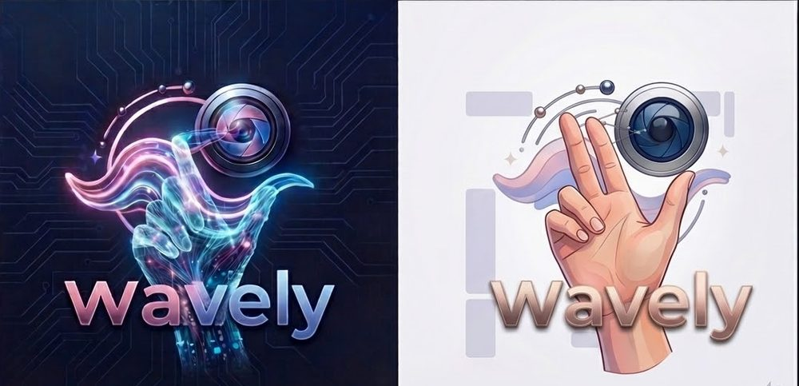

# Wavely - Hand Gesture Control

Control your computer with your hand. This is my capstone project for the General Assembly Data Science Bootcamp.

## The problem

We use a keyboard and a mouse all day. But sometimes our hands are busy, we are far from the screen, or we just want to do many things at the same time (multitasking). Switching between the mouse and the keyboard takes time, and some people cannot use them easily.

## The solution

Wavely uses the webcam to see your hand. You show a gesture, and the computer does the action. No extra device is needed, only a normal camera.

## Use cases

- Multitasking: scroll a page or change the volume while your other hand is busy (for example, when you are cooking or eating).
- Convenience: control a video or a presentation from a distance, without touching the laptop.
- Accessibility: help people who find it hard to use the keyboard or the mouse.

## What the app can do

The app is made with Streamlit. It has a light mode and a dark mode.

- Mouse: point with one finger to move the mouse. Bring the thumb and the index finger together to click (hold them to drag).
- Right click: horns gesture.
- Scroll: show two fingers and move your hand up and down.
- Volume: show three fingers and turn your hand.
- Zoom: show two open hands, then move them apart (zoom in) or together (zoom out). Hold them still to open the keyboard.
- 7 gesture commands from the model: open_palm, victory, ok, fist, thumbs_up, thumbs_down, call_me. Each one can do an action (for example: make a folder, write text, say "Yes" or "No", or send a "please call me" email). You can change the actions inside the app.

The mouse, scroll, volume and zoom gestures use simple rules (which fingers are up). They do not need the model.

## How to run it (Windows)

1. Install the libraries: `pip install -r requirements.txt`
2. Start the app: double click `run_gesture_v2.bat`, or write `streamlit run app_v2.py`
3. Turn the camera on and show your hand.

## What is in the notebook

Hand_Gesture_Capstone.ipynb shows the full data science work, step by step:

1. Collect the data: the webcam records 100 frames per gesture in several sessions.
2. Make features: MediaPipe gives 21 points. We subtract the wrist and divide by the biggest number, so the position and the size of the hand do not matter (42 numbers per frame).
3. Explore the data: 7 gestures x 4 sessions x 100 frames = 2800 rows.
4. Train a Random Forest (100 trees).
5. Test it honestly on a session the model never saw.

## Results

- Train on sessions 1-3, test on session 4: 97% accuracy.
- Train on session 1, test on session 2: 88%.
- Chance level is 14% (1 of 7 gestures).
- The weakest gesture was thumbs_up, because the model sometimes mixed it with call_me. In the app, a simple rule now fixes this: if the little finger is up it is call_me, if it is down it is thumbs_up.

## How a command is protected from mistakes

A command runs only if the model is at least 80% sure, the same gesture is held for 8 frames in a row, and 3 seconds passed since the last command.

## How the app stays fast

The model looks at only 1 frame out of 3, and the picture on the page updates every 2nd frame. This makes the app lighter and faster, and the mouse stays smooth.

## Limits

- The model was trained on my hand, with my camera and light. Other people and other light can give lower accuracy.
- The computer-control part works on Windows only.

## Credits

MediaPipe (Google) for the hand landmarks.
